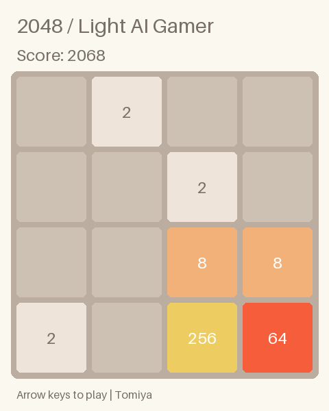

# Light AI Gamer

作者: **Tomiya**

画面画像から判断してゲームを操作するPython製プレイヤーです。
2048の検証済み探索AIに加え、v0.2でWindows実ウィンドウのキャプチャ・キーボード・マウス操作と、
Minecraft用の実験的探索ポリシーを追加しました。標準動作はAPIキー不要です。
Windows版の実機プレイは実行環境に対話デスクトップがないため未検証です。
他ゲームへの入口として、カスタム操作プロファイルと任意のローカル画像対応Ollamaモデルを使えます。

[Windows / Minecraftの実装・検証結果](WINDOWS_RESULTS.md)も参照してください。

検証済みデモ: **連続150ターン / スコア2068 / 最大タイル256 / 自動テスト30件成功**。
[実行報告](RESULTS.md)・[動画](demo/replay.mp4)・[全ターンログ](demo/turns.jsonl)を参照してください。



## 一発起動

Python 3.11以上。Windowsではリポジトリ直下の `run_demo.cmd` を実行します。
Pillowが無ければ固定バージョンを導入し、150ターンをプレイして結果を保存します。

```powershell
.\run_demo.cmd
```

全OS共通の準備と実行:

```sh
python -m pip install -r requirements.txt
python run_demo.py
```

設定例:

```sh
python run_demo.py --turns 150 --seed 7 --depth 2 --output artifacts/my-run
```

出力先は既存フォルダーを上書きしません。省略時はUTC時刻の固有フォルダーになります。
探索深さは1〜3。高速確認は `--depth 1`、動画不要なら `--no-replay`。
要求ターンまで到達すると終了コード0、途中のゲームオーバーは2、例外は非0です。
自動リスタートでターン数を水増ししません。2048達成後もプレイを継続します。

## WindowsでMinecraftを操作する

1. 自分のMinecraftクライアントでワールドを読み込みます。ウィンドウまたはボーダーレス表示、
   一人称視点、HUD表示、標準的な中央十字カーソルを使います。
2. `run_minecraft.cmd` を実行します。5秒以内にMinecraftを前面に戻します。
3. **F8**またはコンソールのCtrl+Cで停止します。前面ウィンドウが変わっても停止します。

```powershell
.\run_minecraft.cmd
```

```sh
python run_minecraft.py --window Minecraft --steps 100 --max-seconds 180
```

標準の `minecraft-explore` は、画像から地面の色、中央の茶色い対象、中央十字カーソルを確認し、
移動・ジャンプ・視点変更・採掘を試します。移動しても画面が変わらなければジャンプと旋回を試します。
茶色い対象の採掘は3.2秒の長押しで、同じ場所での採掘回数も制限します。
色による溶岩・水・木の候補判定はヒューリスティックで、誤検出や見落としがあります。
採掘成功、木材取得、クラフト、生存、ゲーム攻略の達成は保証・判定しません。
メニュー・死亡・読み込み画面を自動操作する機能はなく、十字カーソルが認識できなければ停止します。
この制限は標準の色ベース探索についてです。VLMモードでは、ゲーム内インベントリやクラフト画面も
判断対象にできるよう、メニュー開閉・座標クリック・ホットバー切替を操作定義に含めています。
VLMでの実際のクラフト成功は未検証です。
ワールド作成やMinecraftへのログインを自動化する機能はありません。

ゲームのウィンドウ情報を確認するには:

```sh
python run_minecraft.py --list-windows
python run_minecraft.py --probe
python run_minecraft.py --hwnd 0x123456 --capture window
```

`--hwnd` は一覧の実値に置き換えます。タイトルが複数一致した場合は入力を開始しません。
`--probe` は入力を送らず、デスクトップ・ウィンドウの有無をJSONに記録します。
取得方法は標準の `--capture desktop` が前面ゲームのクライアント領域を取得し、
`--capture window` はPillowのHWND取得からクライアント領域を切り出します。
最小化・黒画面・キャプチャ不可の場合は停止し、ゲーム内部APIへ切り替えません。

出力は `artifacts/windows-<日時>/` の `summary.json`、`profile.json`、`events.jsonl`、
`screenshots/`、GIF、ffmpegがある場合はMP4です。動画は6fpsの確認用で、実時間の再現ではありません。
`events.jsonl` は入力前と結果確認後を分けて記録するため、途中で失敗した操作も区別できます。
`--no-replay` で動画処理を省略できます。

## Windows上の他ゲームへ広げる

Windows入出力はゲーム名に依存しません。ゲーム別に操作プロファイルと判断ポリシーを選びます。
任意ゲームを一律に攻略する学習済みAIを同梱したものではありません。
2048以外の一般ゲームで標準提供する汎用判断アダプターは、ローカルOllamaの画像対応モデルです。

既にインストールしたローカル画像対応モデルを指定します。モデルのダウンロード、モデル変更、
外部APIへの接続は自動実行しません。OllamaのホストはlocalhostのHTTPに限定し、cloud名のモデルは拒否します。

```powershell
python -m light_gamer.desktop --profile generic --window "対象ゲームのタイトル" --policy ollama --model "YOUR_LOCAL_VISION_MODEL" --goal "画面に表示されるゲームの目標"
```

Minecraftでも `--policy ollama --model "YOUR_LOCAL_VISION_MODEL"` を使用できます。
Ollama接続は通信仕様を模擬サーバーで検証しました。実モデルの判断能力は未検証です。
VLMには画像、目標、許可された操作、直近6判断、画面の変化量だけを渡します。
返答はJSON形式で検証し、プロファイルにない操作や不正な座標は実行しません。
推論中はキーを保持せず、推論完了後にもF8・前面状態・時間制限を確認します。

操作設定例（`my-game.json`）:

```json
{
  "name": "my_game",
  "perception": "generic",
  "actions": {
    "move_right": {"keys": ["right"], "seconds": 0.2},
    "point_click": {"buttons": ["left"], "aim": true, "seconds": 0.15},
    "scroll": {"wheel": -1, "seconds": 0.1},
    "wait": {"seconds": 0.2}
  }
}
```

`--profile my-game.json --policy ollama ...` で使用します。
`keys` は英字、数字、矢印、space/shift/ctrl/escape/enter/tab/backspace、F8以外のF1〜F12。
`buttons` はleft/right/middle。`mouse_delta` は相対移動の整数2要素（±500以内）、
`wheel` は±3以内、`seconds` は0.02〜5秒です。F8は緊急停止用に予約しています。
`aim:true` の操作にはVLMが画像に対する正規化座標 `pointer:[x,y]`（各0〜1）を指定し、
対象クライアント領域内の絶対位置へマウスを移動してクリックします。

`desktop/models.py` の `DesktopPort` / `VisualPolicy` / `DesktopPerception` / `DesktopEvaluator` を
実装して `run_desktop_session()` へ注入すれば、VLM以外のゲーム専用探索・認識にも交換できます。
2048用の既存実装とWindows汎用実装は分離しています。

| 共通責務 | Windows版の実装 |
|---|---|
| Win32 API・スキャンコード入力 | `desktop/native.py` |
| 対象・前面状態・緊急停止・解除 | `desktop/windows.py` |
| 画像特徴・画面変化の評価 | `desktop/vision.py` |
| Minecraft探索・ローカルVLM判断 | `desktop/policies.py` |
| 観測→判断→入力→再観測と証跡 | `desktop/session.py` |
| ゲーム別の操作定義 | `desktop/profiles/*.json` |

Win32 SendInputは前面ウィンドウに作用するため、対象の前面状態とPIDを繰り返し確認します。
同じキーやボタンをユーザーが押している場合は操作を開始しません。
フォーカス喪失・F8・例外では、送った押下に対応する解除を試み、解除失敗はエラーとして残します。
クラッシュやOSによる強制終了まで完全な解除を保証するものではありません。

独占フルスクリーン、保護された描画、UIPI、アンチチートなどにより取得・入力できないゲームがあります。
この版はそれらを回避しません。「Windowsなら全ゲームで動作・攻略できる」という互換性保証はありません。
Windows実機でのキャプチャ・入力互換性、Minecraft Java/Bedrockそれぞれの動作確認は今後の検証項目です。

実装時に確認した一次資料:
[SendInput](https://learn.microsoft.com/en-us/windows/win32/api/winuser/nf-winuser-sendinput)、
[KEYBDINPUT](https://learn.microsoft.com/en-us/windows/win32/api/winuser/ns-winuser-keybdinput)、
[Pillow ImageGrab](https://pillow.readthedocs.io/en/stable/reference/ImageGrab.html)、
[Ollama chat](https://docs.ollama.com/api/chat)。

## 手動で2048を遊ぶ

```sh
python -m light_gamer.game --port 8765
```

ブラウザーで http://127.0.0.1:8765 を開き、矢印キーまたはボタンで操作します。
この画面のDOMには盤面の数値はなく、ゲームが描画した画像だけを表示します。
自律デモと手動ゲームは独立したセッションです。

## 構成と観測境界

```text
別プロセスの2048 → PNG画面 → 画素認識 → Expectimax → キー入力
                               ↑                       ↓
                          結果評価 ← 操作後のPNG画面 ← ゲーム
```

| 責務 | ファイル | 入出力 |
|---|---|---|
| テスト用2048 | `game.py` | 独立プロセス、画面PNGと矢印キー |
| 画面取得・入力 | `transport.py` | ローカルHTTPの画像取得とキー送信 |
| 画像認識 | `perception.py` | PNG画素 → 認識盤面・信頼度 |
| 意思決定 | `policy.py` | 認識盤面・元画像 → 操作 |
| 操作結果評価 | `evaluation.py` | 前後の認識盤面 → 合成報酬・終了・不整合 |
| 実行制御・記録 | `runner.py` | 閉ループ、JSONL・画像・動画 |
| 交換用インターフェース | `contracts.py` | Protocol定義 |
| 探索用ルール | `rules.py` | 仮想盤面の移動・合成 |

ゲームは `GET /frame.png` と `POST /key` を提供します。`GET /` は手動表示用の画像ビューアーです。
盤面・スコア・乱数状態を返すAPIはありません。AIはゲームオブジェクトを保持しません。
認識盤面は画像の固定位置にあるタイル色を4点ずつ照合して生成します。
既知のルールと公開された色・レイアウト定義を共有しますが、実行時の内部状態は共有しません。
合成スコアは画像から復元した前後盤面とルールから算出し、画面のスコア数値は読みません。

**画面取得方式:** この版はゲームが描画したラスターフレームバッファのPNGスナップショットを取得します。
OSデスクトップのキャプチャや実キーボード注入ではありません。
実行環境の `PIL.ImageGrab.grab()` が `OSError: screen grab failed` となるため採用しました。
ウィンドウの前面状態や解像度に依存せず、別プロセス越しに画像だけを観測して検証できます。

## 結果確認と安全な停止

`artifacts/<実行日時>/` に保存します。

- `summary.json`: 実ターン数、スコア、最大タイル、実行時間、エラー件数。
- `turns.jsonl`: 各ターンの操作、認識した前後盤面、信頼度、報酬、処理時間、画像SHA256。
- `screenshots/0000.png` 以降: 初期画面と毎操作後の画面。
- `replay.gif`: アニメーション。長時間実行では最大201枚に間引きます。
- `replay.mp4`: ffmpegがPATHにありH.264エンコーダーを使える場合に生成。
- `video_status.txt`: MP4生成の成否。動画失敗時もPNG・ログ・GIFが残ります。

未知の色、画面サイズの変化、サンプル点の矛盾、無反応入力、想定外の状態遷移で停止します。
例外時にもsummaryを保存し、ゲーム子プロセスを終了します。HTTPタイムアウト5秒、起動待ち10秒です。
このゲームは入力応答時に状態が確定します。外部ゲームへの交換時は、アニメーション完了・安定画面の待機を
`ScreenSource` アダプターへ実装する必要があります。

## LLM/VLM・別ゲームへの交換

`Policy.choose(observation, screenshot)` を実装したクラスに置き換えられます。
元画像が渡るためVLMも接続できます。APIキーは標準動作では不要で、LLM実装は含みません。
画面取得は `ScreenSource.capture()`、入力は `InputPort.press()`、認識は `Perception.observe()`、
結果評価は `ResultEvaluator.evaluate()` を実装し、`run_session()` に注入します。
2048以外への対応には認識・行動定義・評価・探索ルールの交換が必要です。

## 自動テストと整形

```sh
python -m pip install -e '.[dev]'
python -m ruff check .
python -m ruff format --check .
python -m pytest -q
```

整形する場合は `python -m ruff check --fix .` と `python -m ruff format .`。
開発用バージョンはpytest 9.1.1、Ruff 0.15.22に固定しています。
テスト生成物は `artifacts/test-temp/<固有ID>/` に保存します。
Windowsの一時領域のアクセス制限を避けるため、OS一時フォルダーとpytestキャッシュは使いません。
テストは合成・方向・質量保存、全対応色、画像異常、遷移不整合、合法手選択、
子プロセスの終了、非公開状態APIの不存在、100ターン統合実行と証跡を確認します。
ゲーム内部状態にアクセスする箇所はゲーム単体テストだけです。
GitHub ActionsにはPython 3.11 / 3.14のテストと整形確認を用意しています。

## 制限

- 認識は同梱2048の固定色・固定レイアウト専用です。一般ゲーム向けOCR/VLMではありません。
- 色対応は65536まで。未知タイルでは誤認識して続行せず停止します。
- 探索は有限深さのヒューリスティック評価で、2048到達を保証しません。
- localhostのテストサーバーには認証がありません。外部公開用ではありません。
- 上記の制限は2048の標準認識・探索に関するものです。Windows版の実入力とキャプチャの制限は前述を参照してください。
